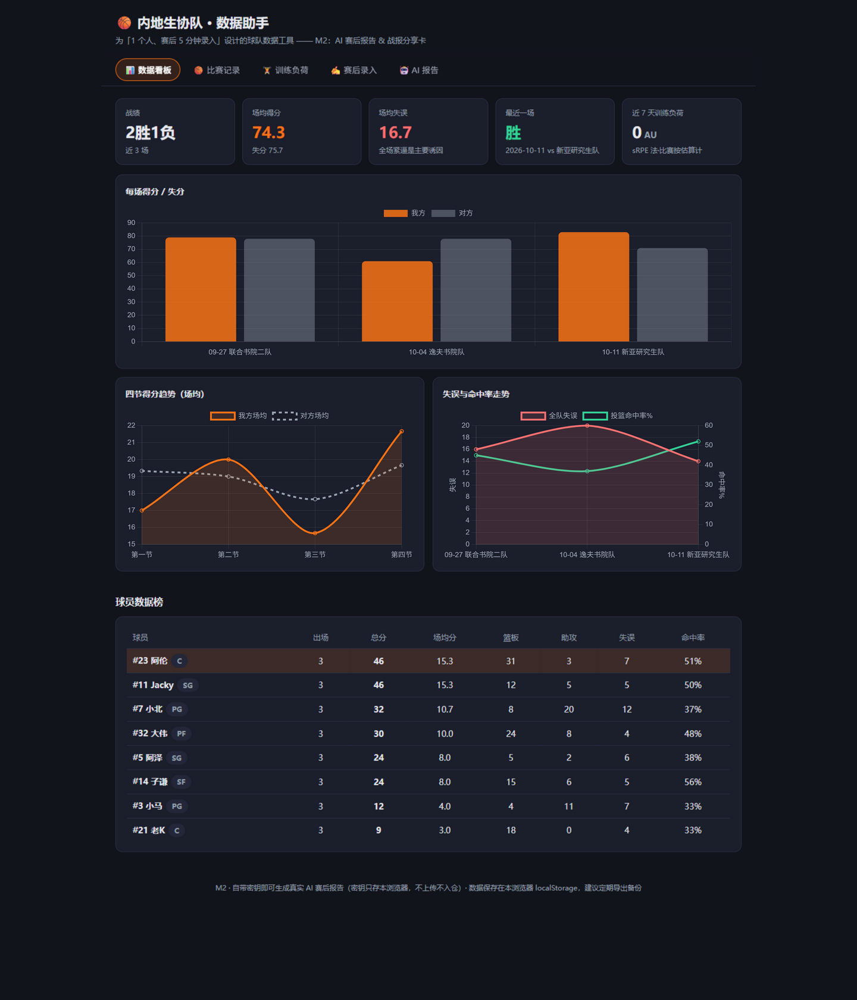
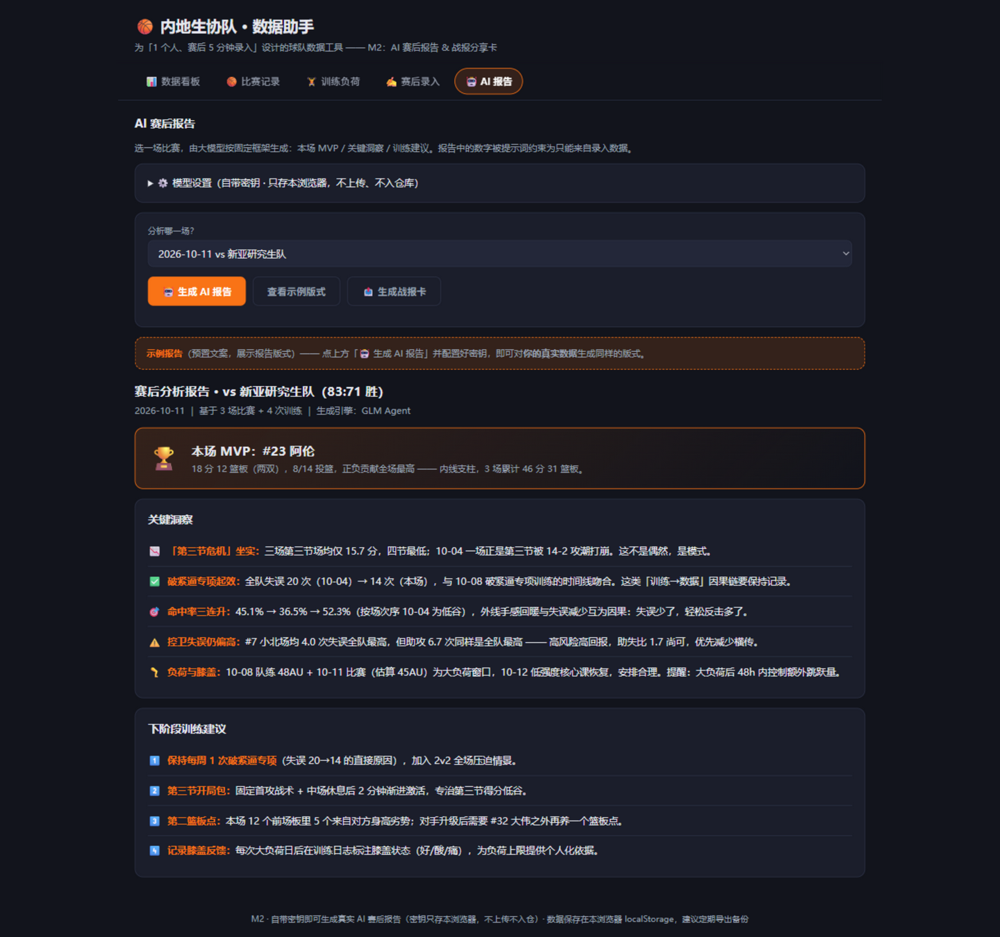
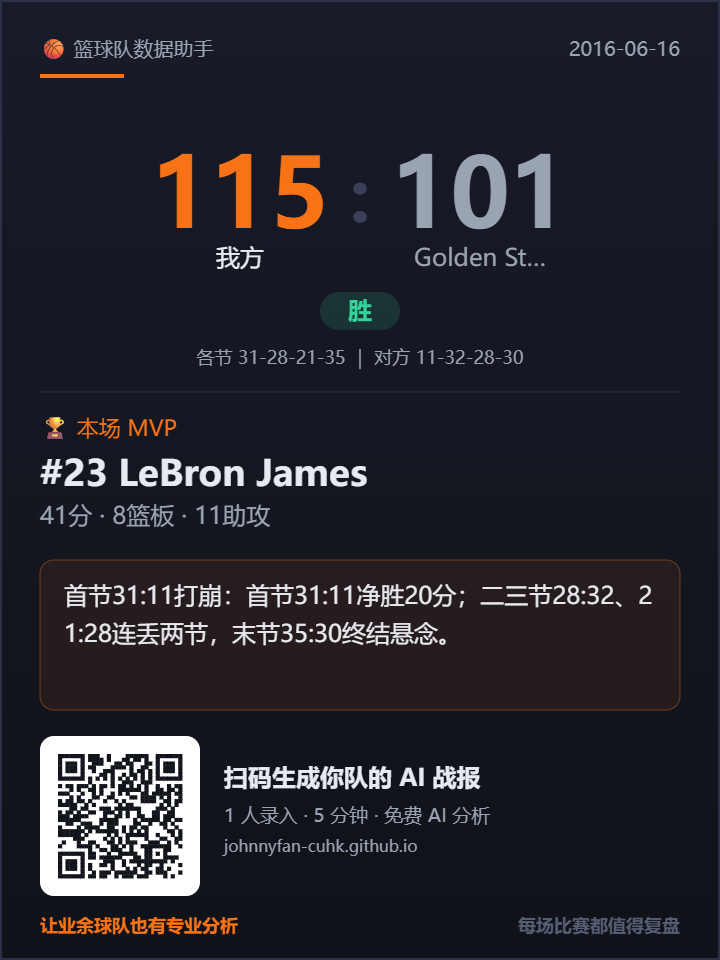
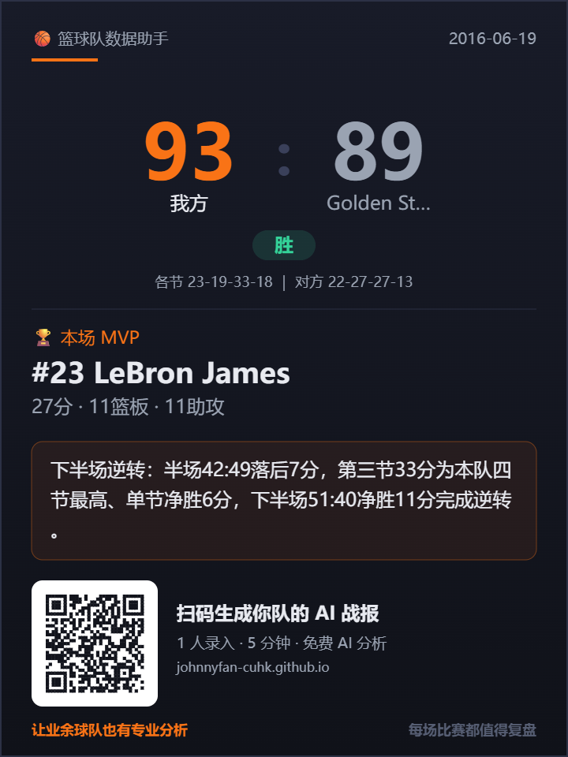
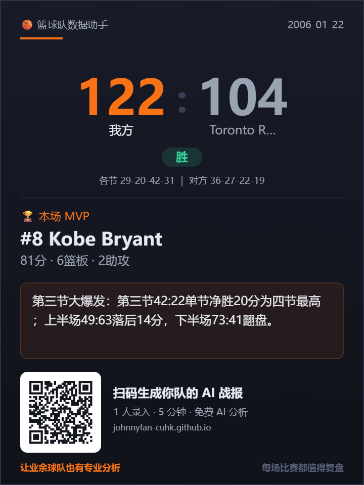

# 🏀 篮球队数据助手 (Basketball Stats Agent)

> 为「1 个人、赛后 5 分钟录入」设计的业余篮球队数据工具。
> 纯前端、零依赖部署、离线可用；M2 已接入真实大模型——赛后 AI 分析报告 + 一键战报分享卡。
>
> 🔗 **在线演示**：[johnnyfan-cuhk.github.io/basketball-stats-agent](https://johnnyfan-cuhk.github.io/basketball-stats-agent/)



## 为什么做这个

调研了 Hudl（$400+/年）、我奥篮球（赛事运营导向，只记录不分析）、HomeCourt（个人训练向）后发现：**业余球队的「赛后 AI 分析层」是完全空白**。所有人都帮你记录数据，没有产品帮你解读数据 —— 为什么输、下阶段练什么。本项目从两个死因入手：录入摩擦（1 人录完）和成本（近零）。

## 核心功能

| 模块 | 说明 |
|------|------|
| 📊 数据看板 | 战绩/场均得分失分/失误 KPI、四节得分趋势、失误×命中率走势、球员数据榜 |
| 🏀 比赛记录 | 按场存档：四节比分、每人 5 项统计、自由文本回顾 |
| 🏋️ 训练负荷 | sRPE 负荷监控 + **ACWR 负荷风险模型**（急性:慢性比，0.8-1.3 最优区，28 天趋势图）+ 负荷×膝盖反馈交叉视图 |
| ✍️ 赛后录入 | 为 1 人录入设计：日期+对手+四节比分+每人 5 个数字+一段口述回顾 |
| 🤖 AI 报告 | 已接入真实大模型（BYO-key，只存本浏览器）：固定分析框架生成 MVP/关键洞察/训练建议，提示词约束数字只能来自录入数据 |
| 📤 战报分享卡 | AI 报告页一键生成 720×960 PNG：比分/胜负/各节/MVP/金句/产品二维码——发群里，对手队扫码进产品 |
| 💾 导出 JSON | 「赛后录入 → 数据管理」一键导出全部数据，随时备份带走 |



## 3 步生成 AI 赛后报告

1. 打开「🤖 AI 报告」→ ⚙️ 模型设置，选服务、填入**自己的** API Key（已实测浏览器直连：**Gemini**、**DeepSeek**；Z.ai（GLM）2026-11-11 起跨域预检不放行暂不可直连；智谱国内站跨域受限需中转；也支持自定义 OpenAI 兼容接口）
2. 选一场比赛，点「🤖 生成 AI 报告」
3. 得到 MVP / 关键洞察 / 下阶段训练建议；满意就点「📤 生成战报卡」存图发群

> 🔐 **隐私**：比赛数据和 API Key 都只保存在你自己的浏览器 localStorage，不上传服务器、不入仓库；建议定期导出 JSON 备份。

**数字不准的 AI 报告没有价值。** 系统提示词约束模型：分析中的数字只能来自录入数据，数据缺失就写「数据不足」。我们用 3 场 NBA 名局的真实数据（[examples/](examples)，含三级对账断言：球员得分和=四节和=总分）实测验证：报告逐条核对零幻觉，标题自动命中「LeBron 27+11+11 三双制胜 93:89」。

<p align="center">
  
  
  
</p>
<p align="center"><sub>战报分享卡：以上均为用名局真实数据实际生成的产品输出</sub></p>

## 快速开始

零依赖，两种方式任选：

```bash
# 方式一：直接双击打开 index.html（Chrome / Edge）

# 方式二：本地起个静态服务（体验与 GitHub Pages 一致）
python -m http.server 8080
# 浏览器打开 http://localhost:8080
```

首次打开自动载入 8 名示例球员 + 3 场比赛 + 4 次训练（数字经过对账：每人得分之和 = 四节总分，界面明确标注「示例」）。可在「赛后录入 → 数据管理」载入示例、导入名局 JSON 或清空。

## 数据模型 v0.1

设计原则：**赛后 5 分钟、1 人录完** —— 其余一切（胜负、场均、命中率、负荷）都在读取时实时计算，不重复存储（单一事实来源）。

```js
// 比赛Game：核心就这一段
{
  id, date, opponent,
  us:   [q1, q2, q3, q4],        // 我方每节得分
  them: [q1, q2, q3, q4],        // 对方每节得分
  review: '自由文本回顾',         // 口述，AI 报告的重要原料
  stats: [                       // 每人一条，没出场整行留空
    { playerId, pts, reb, ast, tov, fg: [命中, 出手] }   // fg 可选
  ]
}

// 训练Training：负荷 = sRPE 法（强度RPE × 分钟 ÷ 10，单位 AU）
{ id, date, type, intensity, minutes, note, knee }   // knee 选填：记录人膝盖反馈 好|酸|痛
```

数据存浏览器 localStorage；「赛后录入 → 数据管理」支持一键导出 JSON 备份。

## 路线图

- **M1（10月中-11月中）** ✅：本原型 + GitHub 上线 + 队友试用反馈
- **M2（11月中-12月中）**：
  - ~~GLM Agent 赛后报告~~ ✅ 已上线：BYO-key 浏览器直连（Gemini / DeepSeek 实测放行；Z.ai 2026-11-11 起跨域预检不放行暂不可直连；智谱国内站需中转）；固定分析框架 + 数字溯源约束
  - ~~导出 JSON~~ ✅ 已上线（录入页 → 数据管理）
  - ~~战报分享卡~~ ✅ 已上线：AI 报告页一键生成 PNG（比分+MVP+金句+二维码）——增长飞轮核心零件（对手队扫码进产品）
  - ~~演示视频~~ 已取消（2026-11-09：不需要视频交付，演示直接用线上 App）
  - ~~README 定稿~~ ✅ 本文
  - ~~负荷-伤病（膝盖）交叉分析~~ ✅ 已上线 v1：训练录入增加膝盖反馈（好/酸/痛，记录人视角），「负荷×膝盖反馈」卡片自动给出大负荷单元（≥40AU）后 48h 酸痛规则提示；膝盖数据同步进入 AI 报告上下文。跨系统自动导入 PersonalAI-OS 训练日志留待后续
- **下一步**：队友试用扩量与商业验证计划见 [BUSINESS.md](BUSINESS.md)
